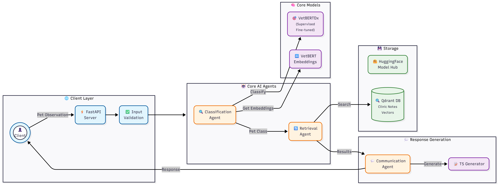

# 🏥 Pet Health AI Assistant


> AI-powered veterinary system for symptom analysis, case retrieval, and patient communication

## 📚 Table of Contents
- [Overview](#overview)
- [Architecture](#architecture)
- [Components](#components)
- [Installation](#installation)
- [Usage](#usage)
- [Features](#features)
- [Testing](#testing)
- [Troubleshooting](#troubleshooting)
- [License](#license)

## 🎯 Overview
This project implements a comprehensive pet health analysis system with three main components:
1. A classification model using VetBERTDx transformer for symptom classification
2. A vector database system for efficient symptom similarity search and retrieval
3. A T5 LLM model to explain clinical terms in simple language

## 🏭 Architecture

**📊 For the full architecture diagram and system design documentation, see [experiments/overview_diagram.md](./experiments/overview_diagram.md)** (Mermaid diagrams render on GitHub).

This multi-agent AI system uses three specialized agents orchestrated through a FastAPI gateway, plus a **triage agent backed by a decision model** (dotted box) added in v2. The triage agent runs at the same time as the classifier and decides, through an escalation gate, whether the classifier's answer can be shown to the owner. See [experiments/README.md](./experiments/README.md) for the idea and results.

```
User ──► FastAPI  POST /converse
                 │
        ┌────────┴──────────────────────┐   both run at the same time
        ▼                               ▼
Classification Agent          ┌╌╌╌╌╌╌╌╌╌╌╌╌╌╌╌╌╌╌╌╌╌╌╌╌╌╌╌╌╌╌╌╌╌╌┐
(fine-tuned VetBERTDx)        ╎ Triage Agent (new in v2)         ╎
        │                     ╎ asks a decision model:           ╎
        │                     ╎ emergency? which condition?      ╎
        │                     ╎ Clef 27B (default)               ╎
        │                     ╎ Clef-flash | d1 | Jev            ╎
        │                     ╎ (chosen by TRIAGE_MODEL)         ╎
        │                     └╌╌╌╌╌╌╌╌╌╌╌╌╌╌╌╌╌╌╌╌╌╌╌╌╌╌╌╌╌╌╌╌╌╌┘
        │                               │
        └───────────────┬───────────────┘
                        ▼
                 Escalation gate ──► urgent-care message (emergency)
                        │        ──► offer an appointment (out of scope,
                        │            disagreement, low confidence)
                        ▼  no rule fires
        Retrieval Agent (VetBERT + Qdrant)
                        ▼
        Communication Agent (T5)
                        ▼
             Response with findings
```

**Key Technologies:**
- **Classification**: VetBERTDx for symptom categorization
- **Retrieval**: TopK-PercPos hard negative mining with Qdrant vector database
- **Communication**: T5 model for clinical term simplification
- **Triage (v2)**: decision model (Clef 27B on Cloudflare Workers AI by default; Clef-flash, Liquid AI d1 or Jev via `TRIAGE_MODEL`) for emergency and out-of-scope checks
- **API Framework**: FastAPI with async support
- **Deployment**: Docker (Qdrant), HuggingFace Hub (models)

## 🔧 Components

### System Architecture



For a more detailed view of the architecture, please see our complete_diagram file in Assets folder.

### 1. Classification System
- **Base Model**: VetBERTDx (havocy28/VetBERTDx)
- **Type**: Fine-tuned BERT for sequence classification
- **Training Data**: Pet health symptoms dataset
- **Hosted Model**: [fdastak/model_classification](https://huggingface.co/fdastak/model_classification)

### 2. Vector Database System 🔍
- **Embedding Model**: VetBERT
- **Vector Database**: Qdrant
- **Features**: 
  - Text vectorization
  - Semantic similarity search
  - Fast retrieval
  - Docker-based deployment

### 3. Communication System 💬
- **Base Model**: T5 for NLG
- **Features**: 
  - Clinical term explanations
  - Appointment scheduling
  - TopK-PercPos Hard Negative Mining
  - Similarity thresholds (0.8)

## 🚀 Installation

### Prerequisites
- Python 3.11+
- Docker (for Qdrant)
- HuggingFace account and token

```bash
# Clone repository
git clone https://github.com/dastakfatemeh/pet_vetClinic.git
cd pet_vetClinic

# Create virtual environment
python -m venv venv
.\venv\Scripts\activate

# Install dependencies
pip install -r requirements.txt
pip install python-dotenv
```

### Environment Configuration
Create a `.env` file in project root:
```plaintext
HUGGING_FACE_TOKEN=your_huggingface_token_here
```

**Security Notes:**
- Never commit `.env` file to repository
- Keep HuggingFace token secure
- Add `.env` to `.gitignore`

### Triage Model (optional)
`/converse` runs a triage check beside VetBERTDx. It flags emergencies, sends out-of-scope messages to an appointment, and overrules the classifier when the triage model is confident it is wrong. The triage model is chosen in `.env`:

```plaintext
# Pick one: clef (default) | clef-flash | d1 | jev | none
TRIAGE_MODEL=clef

# clef / clef-flash on Cloudflare Workers AI (default provider)
CLOUDFLARE_ACCOUNT_ID=...
CLOUDFLARE_API_TOKEN=...      # token with Workers AI permission

# d1: Liquid AI API (hosted, closed weights)
# LIQUID_API_KEY=...

# jev: TypeSafe API (paid, typesafe-sdk, Python >= 3.10)
# TYPESAFE_API_KEY=...

# or clef / clef-flash on your own GPU server with a SystemOne route (e.g. SGLang)
# TRIAGE_PROVIDER=self_hosted
# CLEF_BASE_URL=http://gpu-box:30000
# CLEF_API_KEY=...            # optional

# Optional overrides of the model's default thresholds
# TRIAGE_EMERGENCY_THRESHOLD=0.7
# TRIAGE_DISAGREEMENT_THRESHOLD=0.5
```

| `TRIAGE_MODEL` | Served by | Emergency threshold | Disagreement threshold | Notes |
|---|---|---|---|---|
| `clef` (default) | Workers AI ($0.24 per M input tokens after a free daily allowance) or self-hosted (80 GB GPU) | 0.5 | 0.5 | Free open weights; matched Jev in the evaluation |
| `clef-flash` | Workers AI ($0.038 per M input tokens) or self-hosted (24 GB GPU) | 0.8 | 0.5 | Budget option, weaker check on the classifier |
| `d1` | Liquid AI API ($0.02 per M input tokens) | 0.5 | 0.5 | Cheapest; about as good as Clef, but closed weights |
| `jev` | TypeSafe API | 0.5 | 0.8 | Paid per token |

The thresholds come from [experiments/decider](./experiments/decider/README.md). The Clef and d1 values are provisional: they were chosen on the evaluation messages and still need checking on real traffic and review by a veterinarian.

If the triage model is not configured, or a request fails or times out (3 s, 2 retries), `/converse` logs a warning and falls back to the classifier's 0.8 confidence check. The selected model is reported as `triage.model` in each response.

**Getting Cloudflare credentials (free):** copy the account ID from the Cloudflare dashboard, then create an API token under My Profile → API Tokens using the **"Workers AI" template**. It grants only Workers AI Read and Edit; don't give the token any other permissions, and set an expiry. Clef and Clef-flash on Workers AI were verified live on 2026-11-22 (see [experiments/README.md](./experiments/README.md#running-it) for the full local setup).

**Getting a Liquid AI key (for `d1`):** sign up at [liquid.ai/en/api](https://www.liquid.ai/en/api), create a key in the console, and set `LIQUID_API_KEY`. d1 was verified live on 2026-11-23.

### Qdrant Setup
```bash
# Pull Qdrant image
docker pull qdrant/qdrant

# Run container
docker run -p 6333:6333 -d --name qdrant qdrant/qdrant
```

Then run `Vector_DB.ipynb` once to embed the clinical notes and load them into the `vet_notes` collection. Without this step, `/converse` finds no similar cases.

## 💻 Usage

```bash
# Start FastAPI application
python -m uvicorn AI_Agents:app --reload

# Access API docs
# Open http://127.0.0.1:8000/docs
```

## ⭐ Features
- ML-powered symptom classification
- Semantic similarity search
- TopK-PercPos hard negative mining
- Custom error handling
- Input validation
- Logging system
- Docker support
- CI/CD pipeline

## 🔬 Model Performance

### Current Capabilities
- ✅ Effectively identifies common pet health conditions
- ✅ Strong performance on clear infection indicators
- ✅ Handles standard symptom descriptions
- ❌ Limited accuracy with ambiguous symptoms
- ❌ May struggle with complex or nuanced cases

### Model Limitations & Improvements

The model's performance is fundamentally tied to its training data quality and quantity. Key factors include:

#### Data Foundation
- Training data sourced from [Pet Health Symptoms Dataset](https://www.kaggle.com/datasets/yyzz1010/pet-health-symptoms-dataset) on Kaggle
- Focuses on common pet health conditions and symptoms
- Limited to specific use cases and scenarios

#### Areas for Improvement
1. **Data Quality & Quantity**
   - Expand training data diversity
   - Improve labeling accuracy
   - Include more clinical scenarios

2. **Clinical Coverage**
   - Add breed-specific variations
   - Expand range of conditions
   - Include more complex cases

3. **Validation & Testing**
   - Enhanced expert validation
   - Rigorous clinical testing
   - Regular performance audits

#### Limitations
1. **Species Coverage**
   - Currently focused on common pet conditions
   - Limited cross-species applicability
   - Breed-specific variations may be underrepresented

2. **Clinical Accuracy**
   - Not suitable for actual medical diagnosis
   - Should not replace veterinary consultation
   - Educational and informational purposes only

## ⚠️ Important Disclaimer

**This AI system is for educational and demonstration purposes only.**
- Do not use for real diagnostic purposes
- Always consult a qualified veterinarian for pet health concerns
- This is not a substitute for professional veterinary care

## 🧪 Testing
```bash
# Run all tests
pytest tests/ -v

# Run with coverage
pytest --cov=. tests/
```

## 🔄 CI/CD Pipeline
- GitHub Actions automation
- Multi-Python version testing
- Code quality (flake8)
- Formatting (black)
- Test coverage reporting

## 🛠️ Development Tools
- **Testing**: GitHub Copilot assisted
- **Error Handling**: Custom implementations
- **Code Quality**: Automated checks
- **Documentation**: Standard compliance


## 📄 License
MIT © [dastakfatemeh](https://github.com/dastakfatemeh)

---
