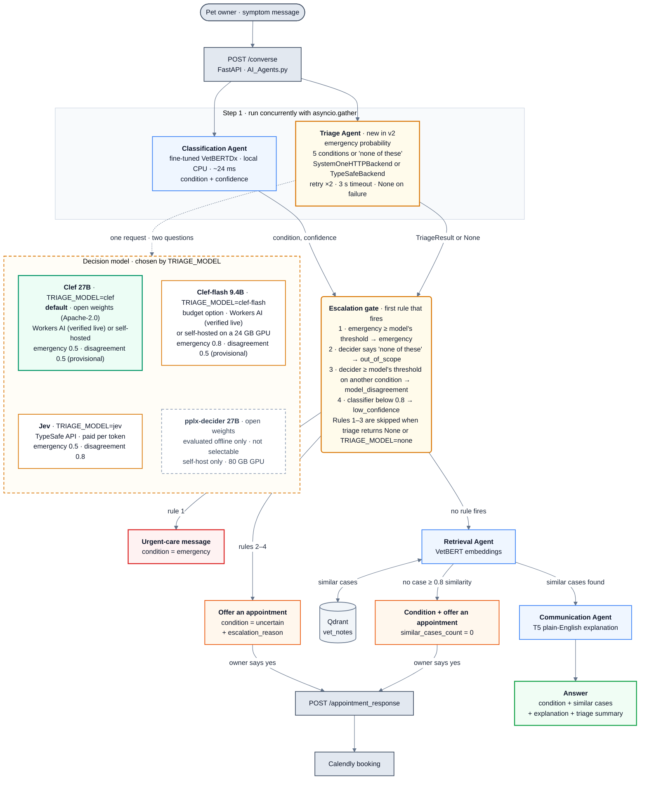

# 🏗️ Pet Health AI Assistant - Architecture Diagram

## 🧭 Architecture v2: Decision-Model Triage

v2 adds a **Triage Agent** that runs at the same time as the classifier in `/converse`. It asks a decision model two questions: "is this an emergency?" and "which of the five conditions, or none of these?". An escalation gate then decides whether the classifier's answer can be shown to the owner. The classification, retrieval and communication agents are unchanged from v1 (described in the sections below).

The decision model is chosen with `TRIAGE_MODEL` in `.env` (`Agents/triage_config.py`). **Clef on Cloudflare Workers AI is the default**, and was verified live on 2026-11-22. Background and results are in [experiments/README.md](./README.md).



| What changed from v1 | Where |
|---|---|
| New Triage Agent, run concurrently with the classifier | `Agents/TriageAgent.py`, `AI_Agents.py` (`asyncio.gather`) |
| Decision model and thresholds chosen in `.env` (`TRIAGE_MODEL`, `TRIAGE_PROVIDER`, optional `TRIAGE_*_THRESHOLD`) | `Agents/triage_config.py` |
| 4-rule escalation gate replaces the single confidence check | `AI_Agents.py` (`_escalation_reason`) |
| Responses include `escalation_reason` and a `triage` summary with the model name | `AI_Agents.py` |
| Falls back to v1 behaviour if triage is off, misconfigured, failing or slow | `AI_Agents.py` (`_run_triage`) |

---

## 🎯 Component Details

### 1. **API Gateway Layer** 🚀

#### FastAPI Application (`AI_Agents.py`)
- **Framework**: FastAPI with async support
- **Key Features**:
  - Request validation (Pydantic models)
  - Error handling & logging
  - Models and clients loaded once at startup, released at shutdown
  - GPU/CPU detection (`cuda` when available, otherwise CPU)
  - Classifier and triage run concurrently (`asyncio.gather`)

#### API Endpoints
| Endpoint | Method | Purpose |
|----------|--------|---------|
| `/ping` | GET | Health check |
| `/converse` | POST | Triage + symptom classification, then case retrieval and explanation |
| `/appointment_response` | POST | Returns the Calendly link on "yes" |

---

### 2. **AI Multi-Agent Ecosystem** 🤖

#### 🛡️ Triage Agent (new in v2)
**Files**: `Agents/TriageAgent.py`, `Agents/triage_config.py`

**Purpose**: Safety checks on the owner's message before the classifier's answer is used

**How it works**:
- One request per message with two questions, sent in the SystemOne format shared by Jev and Clef:
  - `emergency`: yes/no probability that the pet should see a vet within hours
  - `condition`: choice over the five conditions plus "none of these"
- Two backends behind the same `TriageAgent` / `TriageResult`:
  - `SystemOneHTTPBackend`: Clef and Clef-flash on Cloudflare Workers AI or a self-hosted SystemOne server (httpx; handles Cloudflare's `{"result": ...}` envelope)
  - `TypeSafeBackend`: Jev through `typesafe-sdk` (Python ≥ 3.10)
- 3 s timeout and 2 retries; any failure returns `None`, and the gate falls back to v1 behaviour

**Configuration** (`.env`):

| Variable | Values | Default |
|---|---|---|
| `TRIAGE_MODEL` | `clef`, `clef-flash`, `jev`, `none` | `clef` |
| `TRIAGE_PROVIDER` | `workers_ai`, `self_hosted` (Clef models) | `workers_ai` |
| `CLOUDFLARE_ACCOUNT_ID`, `CLOUDFLARE_API_TOKEN` | Workers AI credentials ("Workers AI" token template) | — |
| `CLEF_BASE_URL`, `CLEF_API_KEY` | Self-hosted server | — |
| `TYPESAFE_API_KEY` | Jev | — |
| `TRIAGE_EMERGENCY_THRESHOLD`, `TRIAGE_DISAGREEMENT_THRESHOLD` | Override the model's thresholds | Model presets below |
| `TRIAGE_TIMEOUT_SECONDS` | Per-request timeout | 3 |

| Model | Emergency threshold | Disagreement threshold |
|---|---|---|
| `clef` | 0.5 | 0.5 |
| `clef-flash` | 0.8 | 0.5 |
| `jev` | 0.5 | 0.8 |

The Clef thresholds are provisional: they were chosen on the evaluation messages in [decider/README.md](./decider/README.md).

---

#### 🔍 Classification Agent
**File**: `Agents/ClassificationAgent.py`

**Purpose**: Classifies pet health conditions from symptom descriptions

**Technology Stack**:
- **Model**: `fdastak/model_classification`, fine-tuned by the repo owner from `havocy28/VetBERTDx` (VetBERT trained on 39 veterinary diagnosis classes) on 800 owner observations
- **Base Architecture**: BERT-base for sequence classification (108M parameters)
- **Validation accuracy**: 0.89 on the 200 held-out owner observations (`Clean_Classification.ipynb`)

**Key Features**:
- 5 condition categories:
  - Digestive issues
  - Ear infections
  - Mobility problems
  - Parasites
  - Skin irritations
- Confidence scoring (softmax)
- GPU acceleration support
- Error handling & validation

The model keeps VetBERTDx's 39-output layer and was trained on outputs 0–4; the agent maps those to the five names and returns `"unknown condition"` for any other output.

**Methods**:
```python
predict_condition(user_input: str) -> Tuple[int, float]
identify_condition(user_input: str) -> Tuple[str, float]
```

---

#### 📚 Retrieval Agent
**File**: `Agents/RetrievalAgent.py`

**Purpose**: Finds similar veterinary cases using semantic search

**Technology Stack**:
- **Model**: `havocy28/VetBERT` CLS embeddings (768 dimensions)
- **Vector Database**: Qdrant (Docker-based)
- **Inheritance**: VetBERTMixin for shared functionality

**Key Features**:
- Search filtered to the classifier's condition, 20 candidates
- **TopK-PercPos Hard Negative Mining**, configured in `AI_Agents.py`:
  - `max_neg = 10`: maximum negative examples (class default 4)
  - `percentage_margin = 0.75`: negatives must score ≤ 75% of the top case (class default 0.95)
- Top 3 returned, then `/converse` keeps only cases with similarity ≥ 0.8

With these settings the mined negatives score at most 0.75 × the top score, so they can never reach the 0.8 similarity cut. In practice at most one case (the top match) is shown.

**Methods**:
```python
find_similar_cases(user_input: str, condition: str, limit: int = 3) -> List[Record]
_mine_hard_negatives(query_vector: np.ndarray, cases: List[Record]) -> List[Record]
```

---

#### 💬 Communication Agent
**File**: `Agents/CommunicationAgent.py`

**Purpose**: Generates human-readable explanations of clinical terms

**Technology Stack**:
- **Model**: `google/flan-t5-base`, used off the shelf with a prompt
- **Task**: Clinical term simplification

**Key Features**:
- Clinical entity identification
- Plain language explanations (up to 50 new tokens per case)
- Temperature-controlled generation (0.5)
- Top-p sampling (0.9)
- Duplicate removal

**Methods**:
```python
output_vet_assistant(cases) -> str
_deduplicate_numbered_sections(text: str) -> str
```

---

#### 🧩 VetBERT Mixin
**File**: `Agents/VetBertMixin.py`

**Purpose**: Shared embedding functionality for agents

**Features**:
- Text vectorization using VetBERT (CLS token)
- Numpy/PyTorch output options
- Device management and validation

---

### 3. **External Services** 🌐

#### 🤗 HuggingFace Hub
- **Authentication**: `HUGGING_FACE_TOKEN` via `.env` (all three models are public)
- **Models loaded by the app**:
  - `fdastak/model_classification`: fine-tuned classifier
  - `havocy28/VetBERT`: retrieval embeddings
  - `google/flan-t5-base`: explanations

#### ☁️ Cloudflare Workers AI (new in v2)
- **Models**: `@cf/cloudflare/clef` (default) and `@cf/cloudflare/clef-flash`
- **Endpoint**: `https://api.cloudflare.com/client/v4/accounts/{account_id}/ai/run/@cf/cloudflare/{model}`
- **Pricing**: free daily allowance, then $0.24 (Clef) or $0.038 (Clef-flash) per million input tokens
- **Verified live** on 2026-11-22: 97–98% label agreement with the open weights, 12/12 hard-case emergencies

#### 🧠 TypeSafe API (optional)
- **Model**: Jev, used when `TRIAGE_MODEL=jev`; paid per token

#### 🗄️ Qdrant Vector Database
- **Deployment**: Docker container
- **Port**: 6333
- **Collection**: `vet_notes`, loaded by `Vector_DB.ipynb`
- **Features**:
  - Vector similarity search
  - Metadata filtering
  - Persistent storage

#### 📅 Calendly Integration
- **URL**: https://calendly.com/fhosseinzadh/30min
- **Purpose**: Veterinary appointment scheduling

---

## 🔄 Data Flow Architecture

### Primary Conversation Flow
```
┌──────────────────────────────────────────────────────────────────┐
│ 1. USER INPUT: "My dog is vomiting and has diarrhea"             │
└────────────────────────────┬─────────────────────────────────────┘
                             │
                             ▼
┌──────────────────────────────────────────────────────────────────┐
│ 2. RUN CONCURRENTLY                                              │
│    a. CLASSIFICATION AGENT → "digestive issues" (0.92)           │
│    b. TRIAGE AGENT (Clef) → emergency 0.12,                      │
│                             "digestive issues" (0.88)            │
└────────────────────────────┬─────────────────────────────────────┘
                             │
                             ▼
┌──────────────────────────────────────────────────────────────────┐
│ 3. ESCALATION GATE (first rule that fires)                       │
│    1. emergency ≥ threshold      → urgent-care message           │
│    2. triage: "none of these"    → offer appointment             │
│    3. triage confident elsewhere → offer appointment             │
│    4. classifier < 0.8           → offer appointment             │
│    Rules 1-3 are skipped if triage is off or failed              │
└────────────────────────────┬─────────────────────────────────────┘
                             │ no rule fires
                             ▼
┌──────────────────────────────────────────────────────────────────┐
│ 4. RETRIEVAL AGENT                                               │
│    a. Generate query embedding (VetBERT)                         │
│    b. Search Qdrant with condition filter (20 candidates)        │
│    c. Apply TopK-PercPos hard negative mining                    │
│    d. Return top 3 cases with similarity scores                  │
└────────────────────────────┬─────────────────────────────────────┘
                             │
                             ▼
┌──────────────────────────────────────────────────────────────────┐
│ 5. SIMILARITY THRESHOLD CHECK                                    │
│    - Keep cases with score >= 0.8                                │
│    - If none: return the condition and offer an appointment      │
└────────────────────────────┬─────────────────────────────────────┘
                             │
                             ▼
┌──────────────────────────────────────────────────────────────────┐
│ 6. COMMUNICATION AGENT                                           │
│    - For each case: explain clinical terms with Flan-T5          │
│    - Add appointment question                                    │
│    - Deduplicate output                                          │
└────────────────────────────┬─────────────────────────────────────┘
                             │
                             ▼
┌──────────────────────────────────────────────────────────────────┐
│ 7. RETURN JSON RESPONSE                                          │
│    {                                                             │
│      "condition_identified": "digestive issues",                 │
│      "confidence_score": 0.92,                                   │
│      "similar_cases_count": 1,                                   │
│      "similar_cases": [...],                                     │
│      "triage": {"model": "clef", ...},                           │
│      "conversation": "Here are my findings..."                   │
│    }                                                             │
└──────────────────────────────────────────────────────────────────┘
```

### Appointment Scheduling Flow
```
USER → /appointment_response → yes/no/y/n validation
                    │
                    ├─→ YES: Return Calendly link
                    │
                    └─→ NO:  Thank you message
```

---

## 🔧 Key Algorithms & Techniques

### 1. Decision-Model Escalation Gate (new in v2)
**Location**: `AI_Agents.py` - `_escalation_reason()`

**Logic**:
```python
if triage is not None:                      # triage configured and succeeded
    if triage.emergency_probability >= emergency_threshold:
        return "emergency"
    if triage.condition == "none of these":
        return "out_of_scope"
    if triage.condition != classifier_condition and triage.condition_confidence >= disagreement_threshold:
        return "model_disagreement"
if classifier_confidence < 0.8:
    return "low_confidence"
return None                                 # use the classifier's answer
```

The thresholds come from the configured model (see the Triage Agent section). On the evaluation sets, Clef behind this gate cut wrong answers shown to owners from 17 to 9 of 200 (validation) and from 19 to 6 of 200 (clinical notes), and flagged 12/12 hand-written emergencies. See [README.md](./README.md#results).

---

### 2. TopK-PercPos Hard Negative Mining
**Location**: `RetrievalAgent._mine_hard_negatives()`

**Purpose**: Select informative negative examples alongside the best match

**Algorithm**:
```python
1. Retrieve top 20 candidates from Qdrant (filtered by condition)
2. Identify positive case (highest similarity score)
3. Calculate threshold: positive_score * percentage_margin   # 0.75 in the app
4. Keep candidates scoring at or below the threshold
5. Sort them by similarity (descending)
6. Take the top max_neg hard negatives                     # 10 in the app
7. Return [positive] + [hard negatives]
```

The endpoint then returns the first 3 and keeps only scores ≥ 0.8, so with the app's settings only the positive case can pass.

---

### 3. Confidence-Based Routing (v1, now rule 4)
**Location**: `AI_Agents.py` - `/converse` endpoint

**Logic** (v1; in v2 this runs after the triage rules):
```python
if confidence < 0.8:
    # Low confidence path
    return appointment_recommendation
else:
    # High confidence path
    retrieve_cases()
    if similarity < 0.8:
        return appointment_recommendation
    else:
        return full_analysis
```

---

### 4. Semantic Search Pipeline
**Components**:
1. **Query Encoding**: VetBERT → 768-dim vector
2. **Vector Search**: Qdrant cosine similarity
3. **Metadata Filtering**: Condition-based
4. **Ranking**: Score-based sorting
5. **Mining**: Hard negative selection

---

## 📊 Technology Stack Summary

| Layer | Technology | Purpose |
|-------|-----------|---------|
| **Web Framework** | FastAPI | RESTful API server |
| **ML Framework** | PyTorch | Model inference |
| **Transformers** | HuggingFace | Pre-trained models |
| **Decision model** | Clef / Clef-flash on Cloudflare Workers AI; Jev on TypeSafe (optional) | Triage: emergency and out-of-scope checks |
| **HTTP client** | httpx | Calls to the decision model |
| **Vector DB** | Qdrant | Similarity search |
| **Containerization** | Docker | Qdrant deployment |
| **Validation** | Pydantic | Input/output schemas |
| **Configuration** | python-dotenv | Tokens and triage settings |
| **Testing** | pytest (+ pytest-asyncio) | Unit/integration tests |
| **Code Quality** | flake8, black | Linting & formatting |
| **CI/CD** | GitHub Actions | Automated testing |

---

## 🛡️ Error Handling & Validation

### Custom Exceptions
**File**: `Agents/exceptions.py`

```python
AgentInitializationError  # Agent startup failures (incl. bad triage config)
PredictionError          # Classification failures
SearchOperationError     # Retrieval failures
DatabaseConnectionError  # Qdrant connection issues
CommunicationError       # NLG generation failures
TriageError              # Decision-model request failures (v2)
```

### Input Validation
- **Max length**: 1000 characters
- **Empty check**: Non-empty strings required
- **Type validation**: String enforcement
- **Sanitization**: Whitespace trimming

### Response Validation
- **Confidence range**: [0, 1]
- **Case availability**: Empty result handling
- **Similarity threshold**: 0.8 minimum
- **Appointment responses**: yes/no/y/n only
- **Triage failures**: logged as warnings; the response has `"triage": null` and uses v1 routing

---

## 🚀 Deployment Architecture

### Local Development
```bash
# Environment setup
python -m venv venv
.\venv\Scripts\activate
pip install -r requirements.txt

# Start Qdrant, then run Vector_DB.ipynb once to load the vet_notes collection
docker run -p 6333:6333 -d qdrant/qdrant

# Configure .env (git-ignored)
HUGGING_FACE_TOKEN=...
TRIAGE_MODEL=clef               # clef (default) | clef-flash | jev | none
CLOUDFLARE_ACCOUNT_ID=...
CLOUDFLARE_API_TOKEN=...        # "Workers AI" token template

# Run application (log shows "Triage enabled: model=clef, provider=workers_ai")
uvicorn AI_Agents:app --reload

# Access API docs
http://127.0.0.1:8000/docs
```

Everything except the decision model runs locally on CPU (~1 GB of model downloads, 2–3 GB of memory). Clef runs on Cloudflare; self-hosting it needs an 80 GB GPU (24 GB for Clef-flash). Full instructions: [README.md](./README.md#running-it).

### Production Considerations
- [ ] GPU optimization (CUDA support)
- [ ] Model caching strategies
- [ ] Rate limiting & throttling
- [ ] Request queue management
- [ ] Horizontal scaling (multiple workers)
- [ ] Model versioning
- [ ] A/B testing infrastructure
- [ ] Monitoring & observability, including alerts when triage falls back
- [ ] Validate triage thresholds on real traffic, with veterinary review

---

## 📈 Performance Metrics

### Model Performance
- **Classification accuracy**: 0.89 on owner observations, 0.77 on clinical-style notes
- **Confidence Threshold**: 0.8
- **Similarity Threshold**: 0.8
- **Retrieval Limit**: 3 cases
- **Hard Negatives**: up to 10 (margin 0.75)
- **Triage (Clef)**: 12/12 hand-written emergencies flagged, 10/10 out-of-scope messages escalated

### System Performance
- **Classifier**: ~24 ms per message on CPU
- **Triage (Workers AI)**: ~130–250 ms per call, run concurrently with the classifier
- **GPU Acceleration**: Supported (CUDA)
- **Concurrent Requests**: FastAPI async support
- **Vector Search**: O(log n) with Qdrant HNSW

---

## 🔒 Security & Privacy

### Authentication
- HuggingFace token, Cloudflare API token and TypeSafe key via environment variables (`.env`)
- `.env` and variants excluded from version control (`.gitignore`)
- Cloudflare token limited to Workers AI permissions, with an expiry

### Data Protection
- No PHI (Protected Health Information) storage
- Temporary in-memory processing
- Secure Docker container isolation
- With triage on, owner messages are sent to the decision-model provider (Cloudflare lists zero data retention for Clef)

### API Security
- Input validation & sanitization
- Error message sanitization
- Request size limits

---

## 📚 Data Sources

### Training Dataset
- **Source**: [Kaggle - Pet Health Symptoms Dataset](https://www.kaggle.com/datasets/yyzz1010/pet-health-symptoms-dataset) (`Raw_Data/pet-health-symptoms-dataset.csv`, 2,000 rows)
- **Classifier training**: the 1,000 owner observations (800 train / 200 validation)
- **Coverage**: 5 common pet health conditions

### Vector Database
- **Collection**: `vet_notes`
- **Content**: the dataset's 1,000 clinical notes (short veterinarian notes, ~200 per condition), cached as `data_Clinic.pkl` by `Vector_DB.ipynb`
- **Embedding Model**: VetBERT

### Evaluation Sets (v2 experiments)
- 200 validation owner observations, 200 clinical notes, and 45 hand-written hard cases (`jev/hard_cases.csv`)

---

## ⚠️ Limitations & Future Improvements

### Current Limitations
1. **Species Coverage**: Limited to common pets
2. **Condition Scope**: 5 predefined categories; other problems are escalated by triage rather than answered
3. **Clinical Accuracy**: Educational purposes only
4. **Language Support**: Classifier and explanations are English only (the decision models handled French and Spanish test messages)
5. **Real-time Updates**: Static model weights
6. **Triage thresholds**: provisional, not yet reviewed by a veterinarian

### Planned Improvements
1. **Expand Training Data**:
   - More diverse conditions
   - Cross-species scenarios
   - Breed-specific variations

2. **Enhanced Models**:
   - Fine-tune on larger datasets
   - Multi-label classification
   - Uncertainty quantification

3. **Advanced Features**:
   - Image analysis (X-rays, photos)
   - Multi-turn conversations
   - Follow-up recommendations
   - Integration with EHR systems

4. **Infrastructure**:
   - Model serving optimization
   - Distributed vector search
   - Real-time model updates
   - A/B testing framework

---

## 📖 API Documentation

### Interactive Documentation
- **Swagger UI**: `http://127.0.0.1:8000/docs`
- **ReDoc**: `http://127.0.0.1:8000/redoc`

### Example Request
```bash
curl -X POST "http://127.0.0.1:8000/converse" \
  -H "Content-Type: application/json" \
  -d '{
    "user_input": "My cat has been scratching excessively and has red patches on its skin"
  }'
```

### Example Response (answered)
```json
{
  "condition_identified": "skin irritations",
  "confidence_score": 0.89,
  "similar_cases_count": 1,
  "similar_cases": [
    {
      "score": 0.92,
      "text": "Feline dermatitis with erythema..."
    }
  ],
  "triage": {
    "model": "clef",
    "emergency_probability": 0.04,
    "condition": "skin irritations",
    "condition_confidence": 0.91
  },
  "conversation": "Here are my findings:\n\n1. Feline dermatitis...\n\nWould you like to schedule an appointment?"
}
```

### Example Response (escalated)
```json
{
  "condition_identified": "emergency",
  "confidence_score": 0.97,
  "similar_cases_count": 0,
  "escalation_reason": "emergency",
  "triage": {
    "model": "clef",
    "emergency_probability": 0.98,
    "condition": "none of these",
    "condition_confidence": 0.76
  },
  "conversation": "Based on what you've described, your pet may need urgent veterinary care. ..."
}
```

`escalation_reason` is one of `emergency`, `out_of_scope`, `model_disagreement` or `low_confidence`; for all but `emergency`, `condition_identified` is `"uncertain"` and the owner is offered an appointment.

---

## 🎓 Educational Disclaimer

**This system is for educational and demonstration purposes only.**

- ❌ Not for real medical diagnosis
- ❌ Not a substitute for veterinary care
- ✅ Educational tool for AI/ML learning
- ✅ Demonstration of multi-agent systems
- ✅ Proof of concept for NLP and decision models in healthcare

**Always consult a qualified veterinarian for pet health concerns.**

---

## 📄 License & Attribution

- **License**: MIT
- **Author**: [dastakfatemeh](https://github.com/dastakfatemeh)
- **Repository**: [pet_vetClinic](https://github.com/dastakfatemeh/pet_vetClinic)
- **Dataset**: Kaggle Pet Health Symptoms Dataset
- **Models**: HuggingFace community models; Clef and Clef-flash by Cloudflare (Apache-2.0)

---

## 🤝 Contributing

This architecture document serves as a reference for:
- Understanding system design
- Onboarding new developers
- Planning future enhancements
- Technical documentation

For questions or improvements, please open an issue on GitHub.

---

**Last Updated**: 2026-11-22  
**Version**: 2.0.0 (decision-model triage layer)  
**Status**: Educational proof of concept
